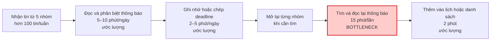
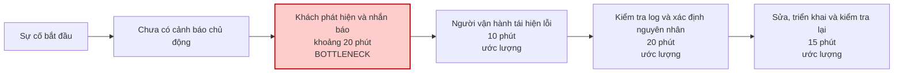
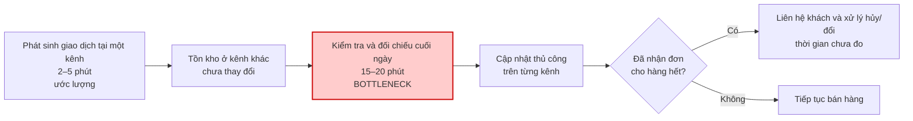

# Báo cáo cá nhân — 2A202603713_LeGiaHung

> Đổi tên file theo quy tắc `MSSV_HoTen.md`, ví dụ `20241234_NguyenVanAn.md` (MSSV trước, dấu `_`, họ tên viết liền không dấu). Sửa cả dòng tiêu đề phía trên cho khớp.
> Template chi tiết và prompt mẫu cho từng mục: [docs/01-worksheet.md](../../docs/01-worksheet.md).
> Mỗi thành viên một file trong `report/individual/` trên repo nhóm: copy template này thành file mới, điền, rồi commit bằng tài khoản GitHub của bạn. Không viết hộ người khác.

## 1. Thông tin học viên

- Họ tên: Lê Gia Hưng
- MSSV:2A202603713
- Email trường (không bắt buộc, repo có thể để public):
- Tên nhóm: ProblemSolver
- Link repo nhóm: https://github.com/QuocAnhtapcode/K5-L3A-DAY02-ProblemSolver-DiscoveryProblemFraming

---

## 2. Scan problem (CP1)

Lăng kính: **Lặp lại** · **Tốn thời gian** · **Cần đọc, tổng hợp nhiều thông tin** · **Pain từ người khác**.

|   # | Lăng kính                         | Job Story: Khi… tôi muốn… để…                                                                                                                                                          | Ai chịu ảnh hưởng?                                          | Dấu hiệu thật (thời gian, tần suất, số người, bằng chứng)                                                                                                                          |
| --: | --------------------------------- | -------------------------------------------------------------------------------------------------------------------------------------------------------------------------------------- | ----------------------------------------------------------- | ---------------------------------------------------------------------------------------------------------------------------------------------------------------------------------- |
|   1 | Pain từ người khác                | Khi website bán hàng gặp sự cố, tôi muốn biết sự cố xuất hiện ở bước nào và người nào cần xử lý, để hoạt động bán hàng không bị gián đoạn quá lâu.                                     | Chủ cửa hàng trực tuyến, nhân viên kỹ thuật, khách mua hàng | Trong 2 tuần, website gặp lỗi 3 lần. Có lần chỉ phát hiện sau khoảng 20 phút khi khách nhắn báo. Mất thêm khoảng 45 phút để xác định và sửa lỗi.                                   |
|   2 | Tốn thời gian                     | Khi cần tìm lại một tài liệu hoặc quyết định cũ, tôi muốn tìm đúng phiên bản thông tin nhanh chóng, để không phải mở nhiều nơi hoặc hỏi lại đồng nghiệp.                               | Nhân viên văn phòng, thành viên nhóm dự án, sinh viên       | Trong tuần, có nhiều lần phải tìm lại tài liệu cũ trong Google Drive, Zalo, Discord, Email và máy tính. Phải hỏi 2 tới 3 người mới tìm được                                        |
|   3 | Lặp lại                           | Khi nhận nhiều yêu cầu hỗ trợ có nội dung tương tự, tôi muốn xác định nhanh nhu cầu và chuyển yêu cầu tới đúng nơi xử lý, để khách hàng không phải chờ quá lâu hoặc hỏi lại nhiều lần. | Nhân viên chăm sóc khách hàng, chủ cửa hàng, khách hàng     | Trong 1 tuần, shop cần trả lời rất nhiều tin nhắn, trong đó có khoảng 70% là hỏi về giá, phí giao hàng và thời gian nhận hàng. Mỗi tin mất khoảng 2-3 phút để đọc và trả lời       |
|   4 | Pain từ người khác                | Khi bán hàng trên nhiều kênh, tôi muốn biết số lượng hàng còn lại chính xác, để không nhận đơn khi sản phẩm đã hết.                                                                    | Chủ shop nhỏ, nhân viên bán hàng                            | Trong 1 tháng, shop phải hủy 3 đơn do hàng đã bán hết ở kênh khác nhưng chưa cập nhật. Mỗi ngày mất khoảng 15–20 phút kiểm tra lại tồn kho.                                        |
|   5 | Tốn thời gian                     | Khi kiểm tra chi phí thuê máy chủ cho dự án cá nhân, tôi muốn biết tài nguyên nào ít được sử dụng, để tránh trả tiền cho những thứ không cần thiết.                                    | Bản thân, người phát triển website                          | Một dự án thuê VPS nhưng chỉ chạy thử vài lần trong tháng. Kiểm tra lịch sử sử dụng cho thấy máy chủ vẫn hoạt động và phát sinh chi phí cả khi không sử dụng.                      |
|   6 | Pain từ người khác                | Khi đi khám bệnh, tôi muốn biết mình còn phải chờ những bước nào và khoảng bao lâu, để chủ động sắp xếp thời gian.                                                                     | Bản thân, người nhà đi khám                                 | Trong một lần khám, người bệnh mất khoảng 3 giờ tại bệnh viện, trong đó khoảng 70% thời gian để chờ đến lượt khám và còn lại là chờ kết quả, hỏi nhân viên để biết bước tiếp theo. |
|   7 | Cần đọc, tổng hợp nhiều thông tin | Khi nhận nhiều tin nhắn từ các nhóm lớp, tôi muốn biết thông báo nào quan trọng và cần thực hiện trước, để không bỏ lỡ lịch học hoặc hạn nộp.                                          | Bản thân, sinh viên, phụ huynh                              | Theo dõi 5 nhóm Zalo, Discord, Email liên quan học tập. Trong một tuần có hơn 100 tin nhắn; từng bỏ lỡ 1 thông báo về hạn nộp bài và phải mất 15 phút tìm lại thông tin.           |
|   8 | Cần đọc, tổng hợp nhiều thông tin | Khi tiền điện tăng so với tháng trước, tôi muốn biết nguyên nhân thay đổi, để điều chỉnh thói quen sử dụng điện trong gia đình.                                                        | Bản thân, gia đình                                          | Hóa đơn điện tăng từ 450.000 đồng lên 680.000 đồng trong một tháng. Gia đình phải xem lại hóa đơn cũ và thói quen sử dụng điều hòa nhưng chưa xác định được nguyên nhân chính.     |
|   9 | Lặp lại                           | Khi chuẩn bị đi chợ, tôi muốn biết trong nhà còn thực phẩm gì và thứ nào cần dùng trước, để tránh mua trùng hoặc để thức ăn bị hỏng.                                                   | Bản thân, người mua sắm trong gia đình                      | Trong 2 tuần, gia đình bỏ đi 3 bó rau và 2 hộp thực phẩm do để quá lâu. Tổng giá trị ước tính khoảng 100.000 đồng; có 2 lần mua trùng đồ đang còn trong tủ lạnh.                   |
|  10 | Lặp lại                           | Khi phải uống nhiều loại thuốc mỗi ngày theo đơn, tôi muốn biết mình đã uống thuốc nào và lúc nào, để tránh quên hoặc uống nhầm.                                                       | Người lớn tuổi, người thân chăm sóc                         | Trong 7 ngày, người thân phải nhắc uống thuốc 9 lần. Có 2 lần người dùng không nhớ đã uống thuốc buổi sáng hay chưa và phải hỏi lại người chăm sóc.                                |

**Nếu có dùng AI để gợi ý thêm:** Tôi tự xác định các nhóm vấn
đề trước, sau đó dùng AI để chuẩn hóa cách viết thành Job Story
và kiểm tra xem problem có đang bị viết thành solution hay không.

Tôi giữ lại các vấn đề về thông báo học tập, sự cố website và tồn
kho đa kênh vì có trải nghiệm hoặc bằng chứng có thể kiểm chứng.
Tôi không chọn các gợi ý quá rộng như “xây trợ lý học tập toàn
diện” vì không có actor, bottleneck và metric cụ thể.

- ***

## 3. Top 3 Problem Cards + quy trình nháp (CP2)

### Bảng chọn top 3

| Rank | Problem                                    | Vì sao chọn                                                                                                                                           | Điều còn chưa chắc                                                                  |
| ---: | ------------------------------------------ | ----------------------------------------------------------------------------------------------------------------------------------------------------- | ----------------------------------------------------------------------------------- |
|    1 | #7 — Thông báo học tập bị trôi             | Trải nghiệm trực tiếp, bằng chứng rõ: 5 nhóm, hơn 100 tin/tuần, đã bỏ lỡ deadline và mất 15 phút tìm lại. Dễ vẽ quy trình và phỏng vấn sinh viên khác | Vấn đề chính là quá nhiều tin nhắn, cách viết thông báo hay thiếu một nơi tổng hợp? |
|    2 | #1 — Phát hiện và xử lý sự cố website      | Evidence mạnh: 3 lỗi/2 tuần, có lần mất 20 phút phát hiện và 45 phút sửa; workflow kỹ thuật rõ                                                        | Bước nghẽn nằm ở phát hiện, phân loại hay tìm người xử lý?                          |
|    3 | #4 — Tồn kho không đồng bộ giữa nhiều kênh | Impact kinh doanh rõ: 3 đơn bị hủy/tháng, 15–20 phút kiểm kho mỗi ngày. Có actor, workflow và bottleneck cụ thể                                       | Cần tiếp cận được chủ shop và dữ liệu đơn hủy thực tế để validation không?          |

### Problem Card #1

| Trường                                    | Nội dung                                                                                                                                                                                                                                                                                                            |
| ----------------------------------------- | ------------------------------------------------------------------------------------------------------------------------------------------------------------------------------------------------------------------------------------------------------------------------------------------------------------------- |
| Job Story                                 | Khi nhận nhiều tin nhắn từ các nhóm lớp, tôi muốn nhận ra thông báo nào cần thực hiện và hạn cuối là khi nào, để không bỏ lỡ lịch học hoặc hạn nộp bài.                                                                                                                                                             |
| Actor                                     | Sinh viên đang theo dõi nhiều nhóm chat phục vụ học tập và tự chịu trách nhiệm quản lý lịch học, bài tập và deadline.                                                                                                                                                                                               |
| Thời điểm / bối cảnh                      | Trong tuần học, đặc biệt khi nhiều môn cùng thông báo lịch học, yêu cầu bài tập và deadline qua các nhóm Zalo, Discord và email khác nhau.                                                                                                                                                                          |
| Quy trình hiện tại (3–7 bước)             | 1. Nhận tin nhắn từ năm nhóm học tập. 2. Đọc lướt và cố nhận ra đâu là thông báo quan trọng. 3. Ghi nhớ hoặc chép thủ công một số deadline. 4. Khi cần kiểm tra, mở lại từng nhóm và tìm bằng từ khóa. 5. Đọc lại hội thoại để xác định yêu cầu và hạn cuối. 6. Ghi việc cần làm vào lịch hoặc danh sách cá nhân.   |
| Bottleneck (bước nào, mất bao nhiêu phút) | Bước 4–5: tìm và đọc lại thông báo trong nhiều đoạn hội thoại mất khoảng 15 phút/lần. Tin quan trọng không có cấu trúc thống nhất, bị trộn với trao đổi thông thường và nhanh chóng trôi khỏi màn hình.                                                                                                             |
| Impact (nếu không giải thì sao)           | Phải theo dõi 5 nhóm học tập với hơn 100 tin nhắn/tuần. Đã bỏ lỡ một thông báo về hạn nộp bài và mất khoảng 15 phút để tìm lại. Hậu quả có thể là nộp muộn, phải hỏi lại bạn học và tiếp tục mất thời gian kiểm tra nhiều nguồn.                                                                                    |
| Success metric (baseline → target)        | Trong thử nghiệm 4 tuần, giảm thời gian tìm lại một thông báo học tập từ baseline 15 phút xuống tối đa 3 phút; đồng thời giảm số thông báo có hành động hoặc deadline bị bỏ lỡ từ 1 thông báo trong tuần quan sát xuống không quá 1 thông báo trong 4 tuần, đo bằng nhật ký tìm kiếm và checklist deadline cá nhân. |
| Phương án không dùng AI                   | Chỉ định một bảng thông báo chính thức; dùng mẫu `[MÔN] – [VIỆC CẦN LÀM] – [DEADLINE]`; chỉ admin đăng trong luồng thông báo; dùng tính năng ghim tin và một lịch deadline chung.                                                                                                                                   |
| Giả thuyết về AI (nếu có)                 | AI có thể đề xuất tin nào chứa hành động, deadline và môn học từ nội dung viết tự do. Sinh viên phải kiểm tra trước khi thêm vào lịch hoặc checklist.                                                                                                                                                               |
| Cảm nhận nhanh                            | Workflow — các bước thu thập, phân loại, xác nhận và đưa vào checklist được xác định trước; chưa cần Agent tự quyết định bước tiếp theo.                                                                                                                                                                            |

Quy trình nháp hiện tại:

### Problem Card #2

| Trường                                    | Nội dung                                                                                                                                                                                                                                                     |
| ----------------------------------------- | ------------------------------------------------------------------------------------------------------------------------------------------------------------------------------------------------------------------------------------------------------------ |
| Job Story                                 | Khi website bán hàng gặp sự cố, tôi muốn biết sự cố xuất hiện ở bước nào và người nào cần xử lý, để hoạt động bán hàng không bị gián đoạn quá lâu.                                                                                                           |
| Actor                                     | Người trực vận hành website của cửa hàng trực tuyến, chịu trách nhiệm tiếp nhận thông tin, phân loại sự cố và chuyển cho đúng người xử lý.                                                                                                                   |
| Thời điểm / bối cảnh                      | Trong thời gian website đang phục vụ khách truy cập và đặt hàng, bao gồm lúc không có nhân viên chủ động kiểm tra website.                                                                                                                                   |
| Quy trình hiện tại (3–7 bước)             | 1. Một chức năng của website gặp lỗi. 2. Khách thử lại hoặc rời website. 3. Khách nhắn báo hoặc nhân viên tình cờ phát hiện. 4. Người vận hành thử tái hiện lỗi. 5. Kiểm tra log và thay đổi gần nhất. 6. Xác định người phụ trách, sửa lỗi và kiểm tra lại. |
| Bottleneck (bước nào, mất bao nhiêu phút) | Bước 2–3: website chưa có kiểm tra chủ động cho luồng quan trọng nên sự cố chỉ được phát hiện sau khoảng 20 phút khi khách phản ánh. Bước kiểm tra log và xác định nguyên nhân trong 45 phút xử lý là bottleneck phụ cần đo riêng.                           |
| Impact (nếu không giải thì sao)           | Website gặp lỗi 3 lần trong 2 tuần. Một sự cố mất khoảng 20 phút mới được phát hiện và thêm khoảng 45 phút để xác định, sửa và kiểm tra lại; tổng thời gian gián đoạn quan sát được khoảng 65 phút. Chưa đo được số khách hoặc đơn hàng bị ảnh hưởng.        |
| Success metric (baseline → target)        | Trong 4 tuần thử nghiệm, giảm thời gian phát hiện sự cố ở luồng đặt hàng từ baseline khoảng 20 phút xuống dưới 5 phút và giảm thời gian chuyển sự cố đến đúng người phụ trách xuống dưới 10 phút, đo bằng timestamp trong nhật ký sự cố.                     |
| Phương án không dùng AI                   | Health check định kỳ; synthetic test cho luồng đặt hàng; cảnh báo khi tỷ lệ lỗi tăng; dashboard log tập trung; runbook xử lý lỗi thường gặp; bảng owner cho từng chức năng.                                                                                  |
| Giả thuyết về AI (nếu có)                 | Nếu alert và runbook chưa đủ, AI có thể tóm tắt log dài, gom các lỗi giống nhau và đề xuất component hoặc owner liên quan. AI không được tự sửa production, restart, rollback hoặc tự kết luận sự cố đã được khắc phục.                                      |
| Cảm nhận nhanh                            | Rule hoặc Workflow — Rule có thể đủ cho bước phát hiện; chỉ cần Workflow có AI nếu việc đọc log và chuyển đúng owner vẫn là bottleneck sau khi đã có alert.                                                                                                  |

Quy trình nháp hiện tại:

### Problem Card #3

| Trường                                    | Nội dung                                                                                                                                                                                                                                                                                           |
| ----------------------------------------- | -------------------------------------------------------------------------------------------------------------------------------------------------------------------------------------------------------------------------------------------------------------------------------------------------- |
| Job Story                                 | Khi bán hàng trên nhiều kênh, tôi muốn biết số lượng hàng còn lại chính xác, để không nhận đơn khi sản phẩm đã hết.                                                                                                                                                                                |
| Actor                                     | Chủ shop nhỏ hoặc nhân viên phụ trách kiểm kho và xác nhận đơn hàng trên nhiều kênh bán. Khi validation cần chốt một actor chính theo người thực sự cập nhật tồn kho.                                                                                                                              |
| Thời điểm / bối cảnh                      | Khi sản phẩm được bán đồng thời tại cửa hàng trực tiếp và các kênh trực tuyến nhưng số lượng tồn kho không được cập nhật ngay giữa các kênh.                                                                                                                                                       |
| Quy trình hiện tại (3–7 bước)             | 1. Khách mua sản phẩm tại một kênh. 2. Nhân viên hoàn tất giao dịch. 3. Số lượng ở các kênh khác chưa được cập nhật. 4. Cuối ngày nhân viên kiểm tra tồn kho thủ công. 5. So sánh và điều chỉnh số lượng trên từng kênh. 6. Nếu đã nhận đơn hết hàng, nhân viên liên hệ khách để hủy hoặc đổi đơn. |
| Bottleneck (bước nào, mất bao nhiêu phút) | Bước 4–5: đối chiếu và cập nhật tồn kho thủ công giữa các kênh mất khoảng 15–20 phút/ngày. Trong khoảng chờ cập nhật, số lượng hiển thị không phản ánh tồn kho thực tế.                                                                                                                            |
| Impact (nếu không giải thì sao)           | Shop phải hủy 3 đơn trong một tháng do sản phẩm đã hết ở kênh khác. Việc kiểm kho mất 15–20 phút/ngày, tương đương khoảng 7,5–10 giờ/tháng nếu thực hiện đủ 30 ngày. Chưa đo được thời gian xử lý từng đơn hủy và doanh thu mất đi.                                                                |
| Success metric (baseline → target)        | Trong pilot 8 tuần, giảm số đơn hủy vì tồn kho sai từ baseline 3 đơn/tháng xuống tối đa 1 đơn/tháng và giảm thời gian kiểm tra tồn kho từ 15–20 phút/ngày xuống dưới 5 phút/ngày, đo bằng log đơn hủy và nhật ký thời gian của nhân viên.                                                          |
| Phương án không dùng AI                   | Chọn một hệ thống làm nguồn tồn kho chính; cập nhật ngay sau giao dịch; dùng phần mềm quản lý bán hàng đa kênh có sẵn; đặt safety stock cho sản phẩm bán nhanh; đối soát theo checklist ở khung giờ cố định.                                                                                       |
| Giả thuyết về AI (nếu có)                 | AI chỉ đáng cân nhắc để phát hiện chênh lệch bất thường hoặc ưu tiên sản phẩm cần kiểm tra. Bài toán đồng bộ tồn kho cốt lõi có input/output rõ và nhiều khả năng chỉ cần Rule, tích hợp dữ liệu hoặc phần mềm có sẵn.                                                                             |
| Cảm nhận nhanh                            | No AI hoặc Rule — chưa có bằng chứng cho thấy Workflow có AI hoặc Agent cần thiết.                                                                                                                                                                                                                 |

Quy trình nháp hiện tại:

### Card muốn pitch nhất

- Card số: **1 — Thông báo học tập bị trôi trong nhiều nhóm chat.**
- Vì sao: Đây là trải nghiệm trực tiếp, có thể tiếp cận người dùng để validation, có baseline ban đầu và quy trình hiện tại dễ quan sát. Bài toán cũng cho phép so sánh rõ No AI, Rule, Workflow và Agent mà không mặc định phải xây giải pháp AI.
- Câu hỏi muốn nhóm phản biện: **Vấn đề thật là sinh viên không tìm được thông báo, hay thông báo ngay từ đầu đã không được viết và quản lý theo một cấu trúc thống nhất?**

### AI đã phản biện card thế nào

| Điểm yếu AI chỉ ra                                                                                   | Đồng ý? | Đã sửa gì                                                                                                                                                       |
| ---------------------------------------------------------------------------------------------------- | ------- | --------------------------------------------------------------------------------------------------------------------------------------------------------------- |
| Metric “không bỏ lỡ thông báo” quá tuyệt đối và baseline mới chỉ có một tuần quan sát.               | Đồng ý  | Đặt thời gian thử nghiệm 4 tuần, đo cả thời gian tìm lại và số thông báo bị bỏ lỡ; ghi rõ baseline cần tiếp tục theo dõi.                                       |
| Card website đang gộp phát hiện và sửa lỗi thành một bottleneck duy nhất.                            | Đồng ý  | Tách thành thời gian phát hiện, thời gian chuyển đúng người phụ trách và thời gian khôi phục; đánh dấu các phút chia từ tổng 45 phút là ước lượng cần kiểm tra. |
| Card tồn kho có nguy cơ nhảy sang dự đoán nhu cầu trong khi vấn đề gốc chỉ là dữ liệu không đồng bộ. | Đồng ý  | Chọn cảm nhận nhanh là No AI/Rule và yêu cầu kiểm tra quy trình, phần mềm đồng bộ có sẵn trước khi cân nhắc AI.                                                 |

---

## 4. Tôi đã tham gia phần nào (CP3 → CP7)

| Hoạt động                  | Tôi đã làm gì?         | Kết quả / ảnh hưởng tới bài nhóm |
| -------------------------- | ---------------------- | -------------------------------- |
| Pitch Problem Card         | Tôi đã pitch ba candidate: #7 — thông báo học tập bị trôi, #1 — phát hiện và xử lý sự cố website, và #4 — tồn kho không đồng bộ giữa nhiều kênh. Với mỗi candidate, tôi trình bày actor, quy trình hiện tại, bottleneck, dấu hiệu thật, impact, success metric dự kiến và phương án không dùng AI. | Ba candidate tạo ra ba hướng so sánh khác nhau: tổng hợp thông tin học tập, vận hành kỹ thuật và quy trình kinh doanh. Nhờ đó, nhóm có thể đánh giá dựa trên evidence và workflow thay vì chọn ngay một giải pháp nghe hấp dẫn. |
| Phản biện bài của bạn khác | Câu hỏi tôi đã đặt cho candidate app/Figma: “Trong hai tuần làm báo cáo ảnh app, bao nhiêu thời gian là thao tác thực để mở đúng màn/trạng thái và bao nhiêu thời gian là chờ build, dữ liệu hoặc quyền truy cập?” | Câu hỏi giúp nhóm nhận ra “mất hai tuần” chưa phải baseline đủ tốt. Muốn xác định bottleneck, nhóm phải bấm giờ từng bước và tách thời gian thực làm khỏi thời gian chờ. |
| Nhận phản biện             | Với Problem Card #1 cá nhân về sự cố website, tôi nhận câu hỏi: “Bottleneck chính là phát hiện sự cố hay tìm nguyên nhân? Nếu health check và alert đã giúp phát hiện sớm thì AI còn tạo thêm giá trị gì?” | Tôi tách thời gian phát hiện khỏi thời gian xử lý, chuyển cảm nhận ban đầu sang Rule/Workflow và đặt health check, alert cùng runbook làm phương án phải thử trước khi cân nhắc AI. |
| Gom cluster / cây OST      | Tôi tham gia phân biệt candidate theo pattern chung thay vì theo tên giải pháp. Candidate tồn kho của tôi được đưa vào danh sách 9 candidate ở vị trí #7 và xếp cùng nhóm các bài cần đối chiếu dữ liệu vận hành. | Việc gom cluster giúp nhóm giữ candidate #7 như một cơ hội cần xem xét, đồng thời hội tụ về candidate #1 app/Figma vì actor, đầu ra và phép thử nhỏ rõ hơn. |
| Chọn candidate problem     | Tôi thống nhất với nhóm chọn candidate #1: dev/tester mất thời gian mở đúng màn và trạng thái app để chụp ảnh đối chiếu với frame Figma. | Nhóm hội tụ về một bài có actor, đầu ra và bước nghẽn cụ thể, đồng thời vẫn có thể so sánh phương án checklist, Rule, Workflow và Agent. |
| Kiểm chứng / research      | Tôi phụ trách chuẩn bị khung phỏng vấn cho dev/tester ngoài nhóm, tập trung vào lần gần nhất họ làm báo cáo ảnh, thời gian từng bước, điểm nghẽn và cách đang xử lý. | Giúp xác định những dữ liệu còn thiếu trước khi triển khai: baseline thời gian, tần suất công việc, quyền truy cập build/design/data và khả năng tái tạo trạng thái. Khi chưa có đủ bằng chứng, tôi đồng ý giữ quyết định ở mức Not Yet. |
| Quy trình nhóm             | Tôi hỗ trợ CP5 ở việc rà luồng mở đúng màn/trạng thái, các điểm cần đo thời gian và yêu cầu giữ bước tester kiểm ảnh cùng phương án quay về thủ công. | Quy trình tương lai không tự động bàn giao ảnh; ảnh vẫn phải được tester kiểm và trường hợp lỗi/chưa chắc phải quay về checklist hoặc thao tác thủ công. |
| Problem Statement          | Tôi đối chiếu Problem Statement v0 và v1 để kiểm tra actor, bottleneck, metric và boundary có nhất quán với candidate đã chọn hay không. | v1 thu hẹp về một app, một nền tảng và 10 trường hợp; bổ sung mức Rule, người kiểm, điều kiện dữ liệu và lý do chưa cần AI intervention point. |
| Mức can thiệp AI           | Tôi theo quyết định nhóm so sánh No AI, Rule, Workflow và Agent, trong đó Rule là giả thuyết đơn giản nhất cần thử trước. | Tránh chọn AI chỉ vì bài toán có nhiều bước. Workflow chỉ được xem xét nếu checklist và Rule vẫn không đạt target sau khi đo. |
| Quyết định                 | Tôi thống nhất kết luận Not Yet cho triển khai vì rủi ro Feasibility còn Cao: chưa có phỏng vấn ngoài nhóm, baseline thực đo, quyền dữ liệu và bằng chứng 10 trạng thái có thể tái tạo ổn định. | Nhóm có bước tiếp theo và ngưỡng dừng cụ thể thay vì triển khai ngay: xác minh quyền, phỏng vấn người thật, đo 10 trường hợp và so checklist với Rule trước khi chuyển Go. |

---

## 5. Dùng AI

Tôi dùng AI ở mức tham khảo và phản biện, chủ yếu để kiểm tra cấu trúc lập luận và chuẩn bị câu hỏi phỏng vấn. Dấu hiệu thật, quyết định của nhóm và kết luận cuối vẫn dựa trên trải nghiệm, dữ liệu có thể kiểm chứng và trao đổi trực tiếp giữa các thành viên.

| Checkpoint                     | Tôi dùng AI để làm gì? | AI hữu ích ở đâu? | AI sai hoặc hời hợt ở đâu? | Tôi sửa gì bằng nhận định của mình? |
| ------------------------------ | ---------------------- | ----------------- | -------------------------- | ----------------------------------- |
| CP1 Scan                       | Tham khảo cấu trúc Job Story và dùng checklist để tự kiểm tra problem có bị viết thành solution hay không. | Giúp tôi diễn đạt rõ tình huống, động cơ và kết quả mong muốn. | AI không biết vấn đề nào tôi thực sự từng gặp và không thể cung cấp bằng chứng hành vi thật. | Tôi chỉ giữ các vấn đề có thể tiếp cận và bổ sung dấu hiệu từ trải nghiệm thực tế của mình. |
| CP2 Problem Card               | Tham khảo bộ câu hỏi phản biện về actor, bottleneck, metric và phương án không dùng AI. | Giúp tôi tách thời gian phát hiện khỏi thời gian xử lý sự cố và nhận ra bài toán tồn kho có thể chỉ cần Rule hoặc phần mềm có sẵn. | Một số thời gian từng bước được gợi ý khi chưa có log chi tiết nên chưa thể coi là số liệu đã đo. | Tôi kiểm tra lại bằng trải nghiệm thật, ghi rõ số nào là ước lượng và ưu tiên phương án đơn giản trước. |
| CP4 Research                   | Tham khảo cách xây câu hỏi phỏng vấn theo The Mom Test và cách phân biệt research với validation người dùng. | Giúp tôi tập trung hỏi về lần gần nhất, hành vi đã xảy ra, thời gian từng bước và tín hiệu phản bác. | AI không thể thay người dùng thật trả lời phỏng vấn. | Tôi chỉ dùng AI để chuẩn bị câu hỏi; câu trả lời và bằng chứng phải đến từ dev/tester được hỏi trực tiếp. |
| CP5 Quy trình                  | Tham khảo checklist actor, input, output, thời gian, điểm kiểm của con người, boundary và fallback. | Giúp tôi nhận ra cần tách thời gian thực làm khỏi thời gian chờ và chi phí setup. | AI không có log thực tế của app nên không thể xác nhận đường đi, dữ liệu test hoặc thời gian từng bước. | Tôi giữ các số chưa đo ở trạng thái minh họa và yêu cầu tester kiểm từng ảnh. |
| CP5–6 Problem Statement        | Tham khảo rubric để tự rà metric, boundary, tiêu chí đánh giá và lý do v1 thay đổi so với v0. | Giúp kiểm tra phạm vi đã được thu hẹp và có người chịu trách nhiệm kiểm kết quả. | Một metric có thể trông hoàn chỉnh trên giấy dù baseline chưa được đo. | Tôi giữ quyết định Not Yet và yêu cầu đo baseline trước khi coi target là khả thi. |
| CP6 Mức can thiệp / quyết định | Tham khảo khung bốn rủi ro và câu hỏi “vì sao mức đơn giản hơn chưa đủ”. | Giúp tôi hiểu vì sao Rule là mức cần thử trước và vì sao chưa cần Workflow hoặc Agent. | AI không thể xác nhận quyền truy cập, khả năng tái tạo trạng thái hay quyết định thay nhóm. | Tôi theo quyết định của nhóm và chỉ chuyển Go khi có phỏng vấn, baseline, quyền dữ liệu và điều kiện pilot rõ ràng. |

---

## 6. Reflection (CP7)

Trả lời bằng trải nghiệm thật của bạn, tối thiểu 200 từ cho các câu 6.1–6.6 (không tính 6.7, câu này được chấm riêng ở tiêu chí C5). **Không dùng AI để viết thay.**

**6.1. Tôi học được gì khi nghe top 3 problems của các bạn khác?**

Khi nghe các candidate của thành viên khác, tôi nhận ra một vấn đề nghe có vẻ lớn chưa chắc đã phù hợp để đào sâu trong một buổi lab. Một số candidate có tác động tiềm năng cao nhưng actor còn rộng, chưa có dữ liệu thật hoặc khó tiếp cận người dùng. Ngược lại, candidate app/Figma có đầu ra là bộ ảnh cần bàn giao, bước nghẽn là mở đúng màn và trạng thái, nên dễ vẽ quy trình và thiết kế phép đo hơn. Tôi cũng học được rằng các candidate thuộc nhiều lĩnh vực vẫn có thể có chung một pattern như tìm đúng vị trí, đối chiếu dữ liệu hoặc xác nhận trạng thái trước khi hành động.

**6.2. Nhóm có lúc nào bị "solution-first" (nghĩ giải pháp trước khi hiểu vấn đề) không? Lúc đó nhóm nhận ra và xử lý thế nào?**

Nhóm có lúc nghĩ ngay đến việc dùng AI để ánh xạ frame Figma với màn hình app hoặc tự điều hướng trong ứng dụng. Khi thảo luận sâu hơn, nhóm nhận ra mình chưa đo được thời gian thực làm và chưa biết bottleneck có thật sự nằm ở bước mở màn hay chủ yếu do chờ build, dữ liệu và quyền truy cập. Nhóm quay lại mô tả actor, workflow, baseline và phương án đơn giản hơn. Kết quả là Rule được chọn làm giả thuyết cần thử trước, thay vì bắt đầu bằng Workflow hoặc Agent.

**6.3. Tôi có đổi ý sau khi bị phản biện không? Kể một lần cụ thể.**

Tôi có đổi ý với Problem Card về sự cố website. Ban đầu tôi nghĩ phần khó nhất là tìm nguyên nhân và có thể cần AI đọc log. Sau khi nhận câu hỏi liệu health check, alert và runbook đã giải quyết được phần lớn vấn đề hay chưa, tôi nhận ra mình đã gộp hai bottleneck khác nhau: phát hiện sự cố và chẩn đoán nguyên nhân. Tôi sửa card bằng cách tách hai khoảng thời gian, lấy Rule và công cụ giám sát làm baseline, chỉ cân nhắc Workflow có AI nếu bước đọc log vẫn là bottleneck sau khi alert đã hoạt động tốt.

**6.4. Kết quả kiểm chứng (phỏng vấn/survey/research) có làm tôi bất ngờ không? Điều gì?**

Điều làm tôi chú ý là các công cụ có sẵn như Figma API, deep link và công cụ chạy kịch bản có thể hỗ trợ từng phần của quy trình nhưng không tự giải quyết được việc ánh xạ đúng frame, màn hình, trạng thái và dữ liệu test. Research vì vậy không chứng minh rằng nhóm cần AI; nó chỉ giúp xác định điều kiện kỹ thuật phải có. Nhóm cũng chưa có phỏng vấn ngoài nhóm và baseline được bấm giờ, nên kết quả hợp lý là Not Yet chứ chưa phải Go. Điều này nhắc tôi rằng research về công cụ không thể thay thế validation với người dùng thật.

**6.5. Điều khó nhất khi viết Problem Statement là gì?**

Phần khó nhất là viết impact và success metric đủ cụ thể mà không biến số liệu minh họa thành kết quả đã đo. Thông tin một đội sáu người làm trong hai tuần cho thấy công việc có quy mô, nhưng chưa cho biết bao nhiêu giờ là thao tác thực, bao nhiêu thời gian là chờ và bước nào chiếm tỷ trọng lớn nhất. Vì vậy, nhóm phải thu hẹp phép thử về 10 màn-trạng thái, đo baseline theo từng bước và tính cả setup, bảo trì cùng trường hợp phải làm lại. Boundary cũng phải nói rõ Rule không được thực hiện giao dịch thật, sửa dữ liệu hoặc tự bàn giao ảnh chưa được tester kiểm.

**6.6. Nếu làm lại, tôi sẽ đổi gì? Tôi sẽ phản biện nhóm mạnh hơn ở điểm nào?**

Nếu làm lại, tôi sẽ thực hiện phỏng vấn và bấm giờ sớm hơn trước khi hoàn thiện Problem Statement. Tôi sẽ hỏi dev/tester về lần gần nhất làm báo cáo ảnh, số trường hợp, thời gian từng bước và nguyên nhân phải mở hoặc chụp lại. Tôi cũng sẽ phản biện mạnh hơn bằng ba câu hỏi: bằng chứng nào chứng minh đây là bottleneck chính, checklist hoặc Rule giải quyết được bao nhiêu phần, và điều kiện nào khiến nhóm phải dừng hoặc quay về thao tác thủ công. Cách này sẽ giúp quyết định Go, Not Yet hoặc No-Go dựa trên dữ liệu hơn là cảm nhận.

**6.7. Hiểu bài:** giải thích bằng 5–8 câu, không nhìn tài liệu, chuỗi _problem → quy trình → metric → boundary → mức can thiệp AI → quyết định_ của bài nhóm mình.

Problem của nhóm là dev/tester mất thời gian mở đúng màn và trạng thái app để chụp đủ ảnh đối chiếu với frame Figma trong báo cáo cho khách hàng. Quy trình hiện tại gồm xác định màn cần chụp, mở app, tái tạo trạng thái, chụp ảnh, đối chiếu thiết kế, ghép báo cáo và kiểm trước khi bàn giao; bottleneck được giả định là bước mở đúng màn/trạng thái nhưng vẫn cần bấm giờ để xác nhận. Nhóm dự kiến đo baseline trên 10 trường hợp cùng phạm vi và đặt target giảm ít nhất 50% trung vị thời gian mở trạng thái cùng tổng thời gian thực làm, đồng thời mọi ảnh đánh dấu hoàn tất phải đúng màn, trạng thái và phiên bản. Boundary là chỉ dùng môi trường, tài khoản và dữ liệu được phép; không giao dịch thật, sửa code/design, tự gửi báo cáo hoặc bỏ bước tester kiểm ảnh. Nhóm chọn Rule vì màn và trạng thái đích đã biết, đường đi có thể mô tả thành kịch bản và chưa có bằng chứng cần AI dự đoán hay tự quyết bước tiếp theo. Workflow hoặc Agent chỉ được xem xét nếu checklist và Rule đã được thử nhưng vẫn không đạt metric. Quyết định hiện tại là Not Yet vì chưa có phỏng vấn ngoài nhóm, baseline thực đo, xác nhận quyền truy cập và bằng chứng rằng 10 trạng thái có thể tái tạo ổn định.

---

## 7. Tài liệu tham khảo

-
